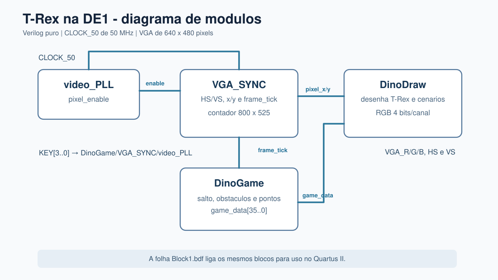
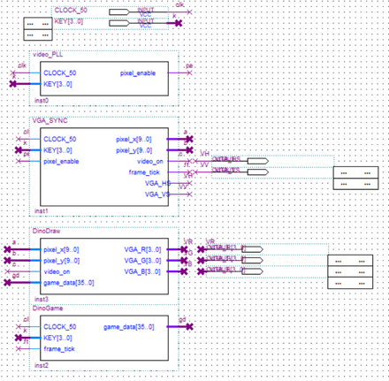
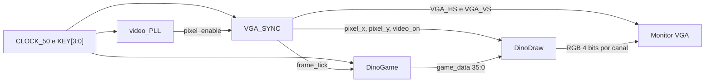

# T-Rex em FPGA — jogo com interface VGA

Implementação acadêmica de Sistemas Digitais, Engenharia de Computação — **Universidade Federal de São Carlos (UFSCar), 2026**. O projeto reproduz uma versão simplificada do jogo do dinossauro conhecido pelo Google Chrome, utilizando a **Terasic DE1 (Cyclone II)** e o **Quartus II 13.0 SP1**.

**O circuito é descrito em Verilog HDL.** Os quatro módulos são interligados pelo esquemático `Block1.bdf`. O repositório conserva o arquivo compactado original `lab_05.7z`, os fontes extraídos, os relatórios históricos, os testes e esta documentação.

| Característica | Configuração publicada |
|---|---|
| FPGA | Terasic DE1, Cyclone II `EP2C20F484C7` |
| Ambiente | Quartus II 13.0 SP1 |
| Projeto principal | [`TREX_VERILOG.qpf`](projeto/lab_05/TREX_VERILOG/TREX_VERILOG.qpf) / topo [`Block1.bdf`](projeto/lab_05/TREX_VERILOG/Block1.bdf) |
| Alternativa de topo | [`TREX_HDL.qpf`](projeto/lab_05/TREX_VERILOG/TREX_HDL.qpf) / [`TREX_TOP.v`](projeto/lab_05/TREX_VERILOG/TREX_TOP.v) |
| Vídeo | VGA, **640 × 480**, 25 MHz de cadência de pixel, **~59,52 Hz** |
| Controles | `KEY0` iniciar/saltar/recomeçar; `KEY1` agachar; `KEY2` voltar ao início; `KEY3` reset |
| Elementos | Dinossauro, cacto, pterodáctilo, pontuação BCD, mensagens de início e fim |

## Arquitetura e demonstração

O módulo `video_PLL` não é uma PLL física: gera **pixel_enable** alternando a cada ciclo de 50 MHz. `VGA_SYNC` produz coordenadas, sincronismos e `frame_tick`; `DinoGame` atualiza as regras; `DinoDraw` desenha os pixels.

## Como jogar

Com o projeto programado na DE1, pressionar **KEY0** para iniciar. Durante a partida, KEY0 solicita um salto e **KEY1**, enquanto pressionado, mantém o personagem agachado no solo. **KEY2** retorna à tela inicial e **KEY3** reinicializa o circuito. Após uma colisão, a mensagem `GAME OVER` aparece e KEY0 permite uma nova partida. Os botões são ativos em nível baixo.

## Guia completo

| Capítulo | Conteúdo |
|---|---|
| [01 — Introdução](docs/01-introducao.md) | Objetivos, plataforma e fundamentos |
| [02 — Arquitetura](docs/02-arquitetura.md) | Diagrama, interfaces e barramento de 36 bits |
| [03 — VGA e temporização](docs/03-vga-temporizacao.md) | Habilitação de pixel, contadores e sincronismos |
| [04 — Lógica do jogo](docs/04-dino-game.md) | Botões, máquina de estados, salto, pontuação |
| [05 — Obstáculos e colisão](docs/05-obstaculos-colisao.md) | LFSR, velocidade, cacto e pterodáctilo |
| [06 — Renderização](docs/06-dino-draw.md) | Sprites, fontes, cores e pontuação na tela |
| [07 — Compilação e gravação](docs/07-quartus.md) | Revisões, pinos, Quartus e JTAG |
| [08 — Resultados e testes](docs/08-resultados.md) | Fotos, testbench, Fitter e TimeQuest |
| [09 — Validação e arquivos](docs/09-validacao.md) | Integridade, dependências e limites das verificações |

## Reprodução rápida

1. Clonar o repositório completo, preservando a estrutura `projeto/lab_05/TREX_VERILOG/`.
2. Abrir [`TREX_VERILOG.qpf`](projeto/lab_05/TREX_VERILOG/TREX_VERILOG.qpf) no Quartus II 13.0 SP1.
3. Conferir o dispositivo `EP2C20F484C7`, o topo `Block1` e os pinos da DE1.
4. Executar **Processing → Start Compilation**; somente após sucesso, programar o `.sof` recém-gerado em modo JTAG.
5. Seguir o [guia de compilação e programação](docs/07-quartus.md).
