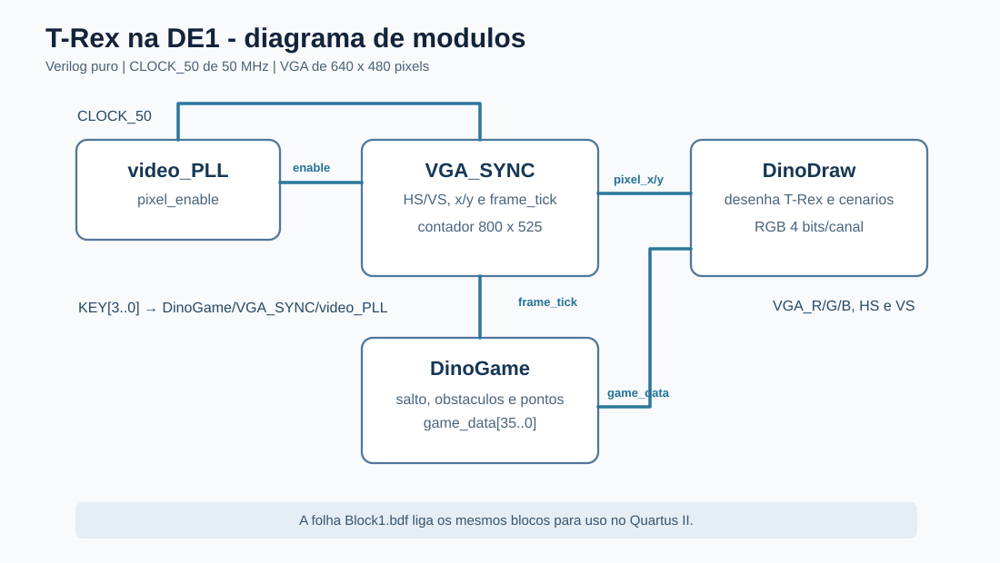

# 02 — Arquitetura e interfaces

A implementação possui quatro módulos principais, integrados em [`Block1.bdf`](../projeto/Block1.bdf) ou pelo [topo Verilog alternativo](../projeto/TREX_TOP.v).



| Módulo | Entradas | Saídas |
|---|---|---|
| `video_PLL` | CLOCK_50, KEY[3:0] | pixel_enable |
| `VGA_SYNC` | CLOCK_50, KEY[3:0], pixel_enable | pixel_x, pixel_y, video_on, frame_tick, VGA_HS, VGA_VS |
| `DinoGame` | CLOCK_50, KEY[3:0], frame_tick | game_data[35:0] |
| `DinoDraw` | pixel_x, pixel_y, video_on, game_data | VGA_R/G/B[3:0] |

## Barramento de estado

A saída de `DinoGame.v` é definida por:

```verilog
assign game_data = {state, jump_y, 1'b0, obstacle_x, 15'd0};
```

| Bits | Campo | Finalidade |
|---|---|---|
| 35–34 | state | READY, RUN ou OVER |
| 33–26 | jump_y | Altura vertical do salto |
| 25 | reservado | Valor constante 0 |
| 24–15 | obstacle_x | Posição horizontal do cacto |
| 14–0 | reservados | Valores constantes 0 |

A interface mantém 36 bits para conexão entre os módulos, mesmo que parte do barramento não seja utilizada.

[Anterior](01-introducao.md) · [Índice](../README.md#tutorial-técnico) · [VGA](03-vga-temporizacao.md)
