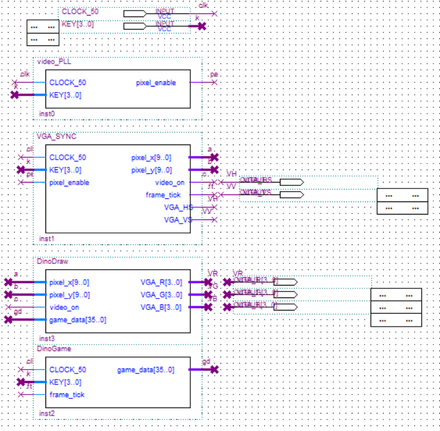
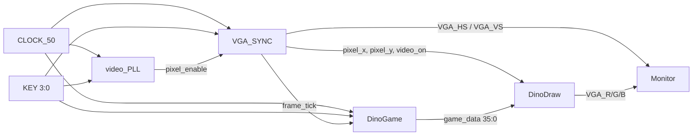

# 02 — Arquitetura e sinais

## Estrutura da integração

O topo principal é [`Block1.bdf`](../projeto/lab_05/TREX_VERILOG/Block1.bdf), com instâncias `video_PLL`, `VGA_SYNC`, `DinoGame` e `DinoDraw`. Uma versão funcionalmente equivalente das conexões também está em [`TREX_TOP.v`](../projeto/lab_05/TREX_VERILOG/TREX_TOP.v), utilizada pela revisão alternativa.

## Interfaces dos quatro módulos

| Módulo | Entradas | Saídas |
|---|---|---|
| `video_PLL` | `CLOCK_50`, `KEY[3:0]` | `pixel_enable` |
| `VGA_SYNC` | `CLOCK_50`, `KEY[3:0]`, `pixel_enable` | `pixel_x[9:0]`, `pixel_y[9:0]`, `video_on`, `frame_tick`, `VGA_HS`, `VGA_VS` |
| `DinoGame` | `CLOCK_50`, `KEY[3:0]`, `frame_tick` | `game_data[35:0]` |
| `DinoDraw` | `pixel_x`, `pixel_y`, `video_on`, `game_data` | `VGA_R/G/B[3:0]` |

## Codificação do estado gráfico

O registrador de 36 bits é organizado, do bit mais significativo ao menos significativo, como `{state, jump_y, ducking, obstacle_x, bird, score, anim, 1'b0}`. A mesma divisão aparece nas atribuições do arquivo gráfico.

| Bits | Campo | Conteúdo |
|---|---|---|
| 35–34 | `state` | READY=0, RUN=1 ou OVER=2 |
| 33–26 | `jump_y` | Altura relativa do salto |
| 25 | `ducking` | Agachamento ativo no solo |
| 24–15 | `obstacle_x` | Posição horizontal do obstáculo |
| 14 | `bird` | 0=cacto; 1=pterodáctilo |
| 13–2 | `score` | Três algarismos em BCD |
| 1 | `anim` | Fase da animação |
| 0 | reservado | Constante zero |

Esse barramento evita dezenas de fios individuais no esquemático. O desenho não altera o estado do jogo: consulta as informações disponibilizadas pelo controlador.

---
[Anterior](01-introducao.md) · [Índice](../README.md#guia-completo) · [Próximo: VGA](03-vga-temporizacao.md)