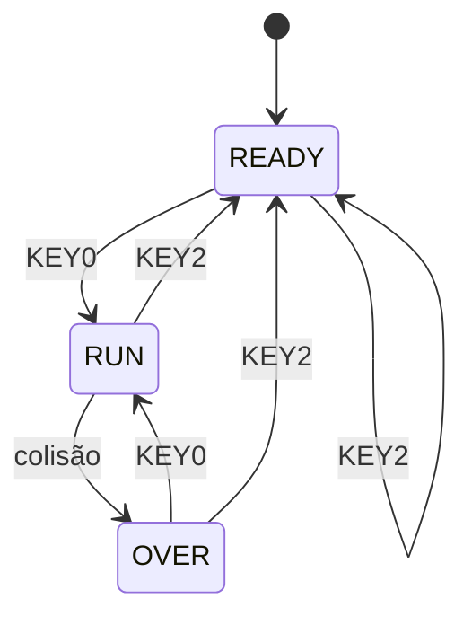

# 04 — Lógica do jogo: DinoGame

## Entradas, saídas e estados

O arquivo [`DinoGame.v`](../projeto/lab_05/TREX_VERILOG/DinoGame.v) recebe o clock de 50 MHz, os quatro botões KEY e o pulso `frame_tick`. Produz `game_data[35:0]` para o módulo gráfico.

Os estados declarados são `READY=0`, `RUN=1` e `OVER=2`. Em READY a aplicação aguarda início; em RUN atualiza movimento e pontuação; em OVER mantém a situação de encerramento. A função gráfica desenha as mensagens `PRESS KEY0` e `GAME OVER` para READY e OVER, respectivamente.

## Mapeamento dos botões

| Entrada | Utilização real |
|---|---|
| `KEY[0]` | Inicia ou reinicia uma corrida; em RUN registra solicitação de salto |
| `KEY[1]` | Agacha enquanto pressionado, quando `jump_y == 0` |
| `KEY[2]` | Solicita retorno ao estado READY e zera a pontuação |
| `KEY[3]` | Reset geral assíncrono, ativo em nível baixo |

Os botões são ativos em zero. As entradas de KEY0, KEY1 e KEY2 passam por registros de sincronização, e os eventos de KEY0 e KEY2 são retidos até o próximo `frame_tick`. **Não há circuito de debounce explícito:** a existência de sincronização não prova eliminação completa de repiques mecânicos.

## Salto

A altura é mantida em `jump_y` e a velocidade vertical com sinal em `jump_v`. No começo do salto, o código atribui altura **12** e velocidade **11**. A cada atualização de quadro, a próxima altura é calculada pela soma das variáveis, e a velocidade diminui uma unidade, aproximando uma trajetória parabólica.

    if (jump_y == 0 && jump_request) begin
        jump_y <= 8'd12;
        jump_v <= 8'sd11;
    end else if (jump_y != 0) begin
        if (predicted_y <= 0) begin
            jump_y <= 0;
            jump_v <= 0;
        end else begin
            jump_y <= predicted_y[7:0];
            jump_v <= jump_v - 8'sd1;
        end
    end

Como a imagem usa o deslocamento `341 - jump`, alturas maiores movem o dinossauro para cima. O salto só pode ser iniciado em solo.

## Pontuação

`score` tem **12 bits** organizados em BCD, três grupos de quatro bits. A função `score_plus_one` atualiza unidades, dezenas e centenas, retornando a 000 após 999. O incremento ocorre a cada **seis** atualizações de quadro durante RUN, o que equivale teoricamente a aproximadamente dez pontos por segundo.

## Animação e aceleração

O sinal `anim` alterna a cada seis atualizações de quadro para mudar detalhes da pose. A velocidade dos obstáculos inicia em 5 e pode aumentar até 11 após intervalos de 360 quadros. O uso de um limite impede crescimento indefinido.

---
[Anterior](03-vga-temporizacao.md) · [Índice](../README.md#guia-completo) · [Próximo: obstáculos](05-obstaculos-colisao.md)